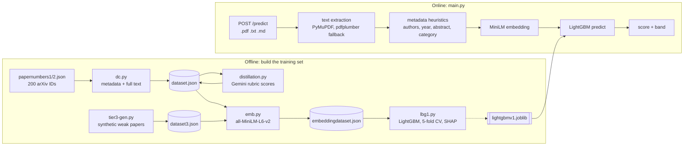
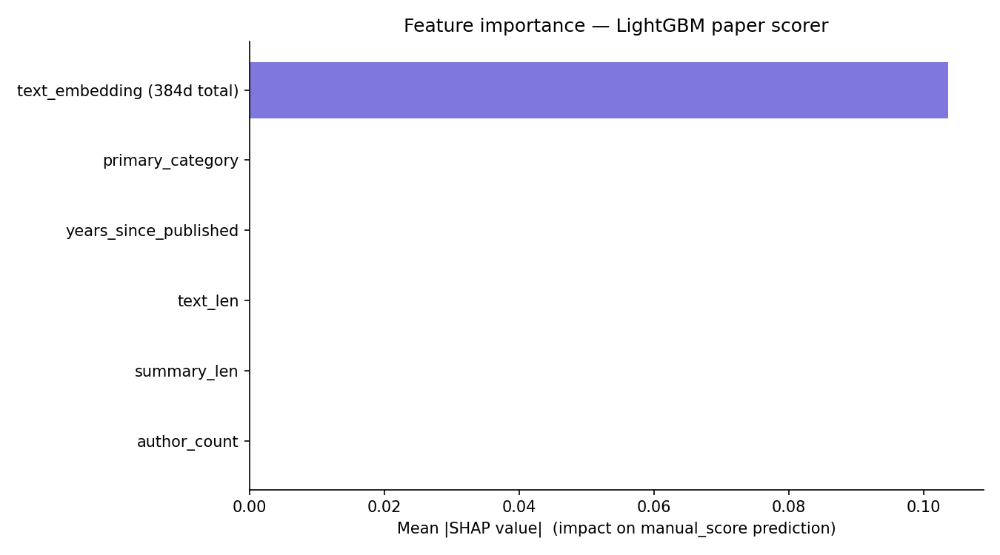

# AuthScore

Scores an AI/ML research paper from 0 to 100 using only the PDF.

A Gemini reviewer scores papers offline against a fixed rubric (novelty, rigor, impact). A LightGBM model trains on those scores and serves predictions from a FastAPI endpoint. No LLM runs in the request path.

[](https://github.com/MallamTeja/research_papers_authscore_predictor/actions/workflows/ci.yml)


---

## Why distill instead of calling an LLM per request

Calling an LLM on every request is slow, costs money each time, needs an API key in production, and can return a different score when you rerun the same paper. Distillation pays that cost once, when the training set is labelled. At serve time the service runs a 24 KB LightGBM booster on a 384-dimension sentence embedding, on CPU, with no network calls.

| | LLM per request | This service |
|---|---|---|
| Secrets in production | Gemini API key | None |
| Cost per request | One LLM call | CPU only |
| Same input, same score | Not guaranteed | Yes |
| Explainable | Free-text reasoning | SHAP per feature |

## How it works



### Pipeline stages

| Stage | Script | Reads | Writes | What it does |
|---|---|---|---|---|
| 1. Collect | `dc.py` | `papernumbers1.json`, `papernumbers2.json` | `dataset.json` | Pulls metadata from the arXiv API and full text from the PDF (capped at 2M chars). |
| 2. Label | `distillation.py` | `dataset.json` | `dataset.json` (in place) | Scores each paper with Gemini 2.5 Flash-Lite against the rubric below. |
| 3. Augment | `tier3-gen.py` | `dataset.json`, `dataset3.json` | `dataset3.json` | Generates deliberately weak papers (score capped at 40) so the low end of the scale has examples. |
| 4. Embed | `emb.py` | `dataset.json`, `dataset3.json` | `embeddingdataset.json` | Embeds paper text with `all-MiniLM-L6-v2` (384-d) and drops the raw text. Fully scored rows only. |
| 5. Train | `lbg1.py` | `embeddingdataset.json` | `shap_bar.png`, `shap_summary.png` | Trains LightGBM with L1 loss and early stopping, runs k-fold CV, and writes SHAP plots. |

Every stage can resume. `dc.py`, `distillation.py` and `emb.py` skip records they have already processed, and `tier3-gen.py` tops up to its target count. All four write to disk as they go and save on Ctrl+C, so a crash or a free-tier quota error does not throw away finished work.

### The rubric

`distillation.py` sends Gemini this scale and asks for JSON only:

| Axis | Range | Top band means |
|---|---|---|
| Novelty | 0-33 | A concept the field has not seen |
| Rigor | 0-33 | Strong baselines and thorough ablations |
| Impact | 0-34 | Changes how the field works |

The response is parsed, each axis is range-checked, and the total is recomputed from the three axes. The script never trusts the model's own arithmetic. Failed parses retry 3 times with a 70 s backoff, and successful calls are spaced 10 s apart to stay inside the Gemini free tier.

### Features

389 columns per paper, built in the same order in training (`lbg1.py`) and serving (`main.py`):

| Feature | Training source | Serving source |
|---|---|---|
| `author_count` | arXiv API | Regex over the header above the abstract |
| `summary_len` | arXiv abstract | Abstract extracted from the text |
| `text_len` | PDF full text | Uploaded file text |
| `years_since_published` | arXiv publish date | First year found in the first 5,000 chars |
| `primary_category` | arXiv category | Keyword match across 6 arXiv categories |
| `emb_0` to `emb_383` | MiniLM on full text | MiniLM on the first 5,000 chars |

The rubric sub-scores (`novelty_score`, `rigor_score`, `impact_score`) never enter the feature matrix, because they would leak the target.

## Quickstart

Python 3.10 or newer.

```bash
python -m venv .venv
source .venv/bin/activate          # Windows: .venv\Scripts\activate
pip install -r req.txt
uvicorn main:app --reload --port 8000
```

Interactive docs: http://localhost:8000/docs

```bash
curl -F "file=@paper.pdf" http://localhost:8000/predict
```

Illustrative response:

```json
{
  "score": 81.37,
  "score_rounded": 81,
  "confidence_band": "strong",
  "extracted": {
    "author_count": 6,
    "summary_len": 498,
    "text_len": 61234,
    "years_since_published": 3.0,
    "publish_year": 2023,
    "primary_category": "cs.CL",
    "summary_preview": "We introduce ..."
  }
}
```

`extracted` shows the metadata the service inferred, so you can see why a score came out the way it did.

## API

| Method | Path | Description |
|---|---|---|
| `POST` | `/predict` | Multipart upload. One field: `file` (`.pdf`, `.txt`, or `.md`). |
| `GET` | `/health` | `{"status": "ok" \| "degraded", "model_loaded": bool}` |
| `GET` | `/docs`, `/redoc` | OpenAPI UI |
| `GET` | `/` | Redirects to `/docs` |

### Score bands

| Score | `confidence_band` |
|---|---|
| 85 and above | `exceptional (top tier)` |
| 70 to under 85 | `strong` |
| 50 to under 70 | `moderate` |
| 30 to under 50 | `below average` |
| Under 30 | `weak` |

`confidence_band` names a score range. It is not a statistical confidence. Raw model output is clamped to 0-100 before banding.

### Errors

| Status | Cause |
|---|---|
| `400` | File extension is not `.pdf`, `.txt` or `.md`, or the text cannot be decoded. |
| `422` | Extracted text is under 200 characters, or no text could be extracted from the PDF. |
| `500` | Embedding or model inference failed. The message carries the cause. |

## Rebuild the dataset and model

The pipeline has heavier dependencies than the service and needs a Gemini API key.

```bash
pip install -r requirement.txt
cp .env.example .env               # then set GEMINI_API_KEY
python test_apillm.py              # confirms the key works and has quota

python dc.py                       # or: python dc.py 25  to cap the batch
python distillation.py
python tier3-gen.py
python emb.py
python lbg1.py
```

## Current data

Snapshot at commit `e74e4ad`:

| | Count |
|---|---|
| arXiv IDs listed | 200 (100 per file) |
| Papers fetched into `dataset.json` | 181 (arXiv returned nothing for 19) |
| Real papers scored by Gemini | 66 of 181 |
| Synthetic weak papers in `dataset3.json` | 42 |
| Rows in the training set | 65 (45 real, 20 synthetic) |
| Score range in the training set | Real 60-94, synthetic 5-15 |

Real papers by primary category: `cs.CL` 54, `cs.LG` 48, `cs.CV` 43, `stat.ML` 8, others 28.

## Explainability

`lbg1.py` runs a SHAP `TreeExplainer` on the trained model. The bar chart groups all 384 embedding dimensions into one bar.



`shap_summary.png` holds the per-paper beeswarm view.

## Testing

```bash
pip install -r req.txt pytest
pytest testmain.py -v
```

92 tests in 14 classes cover the text-parsing helpers, every endpoint, the response contract, edge cases (empty files, bad encodings, score clamping) and a boot smoke test. The model and embedder are mocked, so the suite runs without downloading weights. GitHub Actions runs it on every push and pull request to `main`.

Two scripts measure the LightGBM step on precomputed embeddings:

- `python inferencetest.py` times one prediction and compares it with the stored label.
- `python throughputtest.py` runs about 1,000 predictions and reports predictions per second.

`/predict` also logs time per stage (file read, metadata, embedding, prediction) to stdout.

## Deployment

`render.yml` is a Render blueprint. The build installs `req.txt` and downloads the MiniLM weights, so the first request does not wait on Hugging Face. Render health-checks `/health`. The service needs no environment variables, because Gemini runs only in the offline pipeline.

`req.txt` holds the serving dependencies, which Render and CI install. `requirement.txt` holds the full pipeline dependencies (arXiv, Gemini, SHAP, plotting).

## Repository layout

```
main.py                  FastAPI service: parsing, features, /predict, /health
lightgbmv1.joblib        Trained LightGBM booster loaded by main.py

dc.py                    Stage 1: arXiv metadata and full text
distillation.py          Stage 2: Gemini rubric labels
tier3-gen.py             Stage 3: synthetic weak papers
emb.py                   Stage 4: MiniLM embeddings
lbg1.py                  Stage 5: training, cross-validation, SHAP

testmain.py              pytest suite for main.py
inferencetest.py         Single-prediction latency
throughputtest.py        Batch throughput
test_apillm.py           Gemini key and quota check

papernumbers1.json       arXiv IDs, batch 1
papernumbers2.json       arXiv IDs, batch 2
dataset.json             Real papers: metadata, full text, labels
dataset3.json            Synthetic weak papers
embeddingdataset.json    Training set: features, embeddings, labels

req.txt                  Serving dependencies
requirement.txt          Pipeline dependencies
render.yml               Render deployment
```
